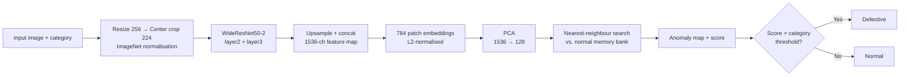

<div align="center">

# 🔍 Inspectra

### AI-Powered Industrial Visual Inspection

Upload a product image, pick its category, and get a **normal / defective** verdict with an **anomaly score** and a **heatmap** showing *where* the defect is.


</div>

---

## 📌 Overview

Inspectra detects anomalies in industrial product images **without needing defective samples for training**. It learns what *normal* looks like for each product category from defect-free images, then flags anything that deviates from it at inference time.

The approach is **PatchCore-inspired**: pretrained CNN features are extracted per image patch and compared against a compact memory bank of normal patches. Patches that sit far from anything "normal" light up on the anomaly heatmap.

> ⚠️ **Honest note:** Inspectra is a *PatchCore-inspired* scalable approximation, **not** an exact reproduction of PatchCore. See [Methodology](#-methodology) for the differences.

---

## ✨ Features

- 🖼️ **Upload and inspect** any product image from the browser
- 🗂️ **Category-aware detection** across the 15 MVTec AD categories
- 🧮 **Anomaly score + threshold** shown with every prediction
- 🌡️ **Anomaly heatmap** and **defect-localization overlay**
- ⏱️ **Processing time** reported per inspection
- ⚡ **FastAPI backend** serving a lightweight HTML/CSS/JS frontend

### What you get back for each image

| Output | Description |
| --- | --- |
| Category | The product category you selected |
| Prediction | `Normal` or `Defective` |
| Anomaly score | Nearest-neighbour distance score (a *model score*, not a probability) |
| Threshold | Category-specific decision threshold |
| Processing time | Inference time for the request |
| Heatmap | Patch-level anomaly map |
| Localization | Overlay highlighting the suspected defect region |

---

## 🧠 Methodology



### Pipeline details

1. **Preprocessing:** resize to 256 × 256, center-crop to 224 × 224, convert to tensor, apply ImageNet normalisation.
2. **Feature extraction:** ImageNet-pretrained **WideResNet50-2**, taking intermediate features from `layer2` and `layer3`.
3. **Feature fusion:** `layer3` is upsampled and concatenated with `layer2`, giving a **1536-channel** feature map.
4. **Patch embeddings:** 784 patches per image, each L2-normalised.
5. **Dimensionality reduction:** PCA from **1536 → 128** dimensions to cut memory and distance-computation cost.
6. **Memory bank:** normal patches are compressed with **MiniBatchKMeans** to a target of **2048 × 128** representatives per category.
7. **Scoring:** nearest-neighbour distance from each test patch to the memory bank produces the anomaly map and image-level score.
8. **Decision:** the score is compared with a **category-specific threshold**.

### How this differs from canonical PatchCore

| | Canonical PatchCore | Inspectra |
| --- | --- | --- |
| Memory-bank reduction | Greedy coreset subsampling | **MiniBatchKMeans** representatives |
| Dimensionality | Random projection used for coreset selection | **PCA (1536 → 128)** applied to features |

MiniBatchKMeans keeps the memory bank small and inference fast, but its effect on detection quality has not yet been separately measured.

---

## 📊 Results

Figures from earlier project evaluation on MVTec AD:

| Metric | Mean over categories |
| --- | --- |
| Image AUROC | ≈ **0.92** |
| Pixel AUROC | **0.9327** |

> 📝 **These are reported results.** They have not been independently reproduced in the project audit. Evaluation scripts, split definitions and per-category metrics are still to be published in `results/`.

### Known limitation

A good `zipper` test image was once flagged defective (score `0.3574` vs. threshold `0.3482`). This is a threshold-calibration issue, and is being investigated through score-distribution analysis rather than by arbitrarily lowering thresholds.

---

## 🗂️ Project Structure

```
Inspectra/
├── backend/
│   ├── app/
│   │   ├── main.py          # FastAPI app, static mounts, home route, /predict endpoint
│   │   └── ml_engine.py     # Model loading and inference
│   ├── models/              # Trained artifacts (excluded from Git)
│   ├── uploads/             # Uploaded + generated images (excluded from Git)
│   └── test_ml.py           # ML test script
├── frontend/
│   ├── index.html
│   ├── script.js
│   └── style.css
├── notebooks/               # Experiments
├── research/                # Research notes
├── results/                 # Evaluation outputs
├── requirements.txt
├── README.md
└── .gitignore
```

---

## 🚀 Getting Started

### ⚠️ Read this first: model files are not in the repo

Trained model artifacts (`*.pth`, `*.pt`, `*.pkl`, `*.npy`, `backend/models/`) are **intentionally excluded from GitHub**. A fresh clone **cannot run inference** until you either:

- generate the per-category artifacts yourself from the MVTec AD training images, **or**
- obtain them separately and place them in `backend/models/`.

A dedicated `MODEL_SETUP.md` is planned (see the [Roadmap](#-roadmap)).

### Prerequisites

- Python 3.x (a tested version will be pinned soon)
- `git`
- MVTec AD dataset (only needed if you are training or evaluating)

### Installation

```bash
# 1. Clone
git clone https://github.com/vikasgjv/Inspectra.git
cd Inspectra

# 2. Create a virtual environment
python -m venv backend/.venv-clean
source backend/.venv-clean/bin/activate      # Windows: backend\.venv-clean\Scripts\activate

# 3. Install dependencies
pip install -r requirements.txt
```

### Run the app

From the project root:

```bash
python -m uvicorn backend.app.main:app --host 127.0.0.1 --port 8000
```

Then open **http://127.0.0.1:8000** in your browser. Stop the server with `Ctrl + C`.

### Using it

1. Click to select an image.
2. Choose the product category (e.g. `bottle`, `zipper`, `screw`).
3. Press **Inspect Image**.
4. Review the prediction, score, threshold, heatmap and localization overlay.

---

## 🧱 Tech Stack

| Layer | Tools |
| --- | --- |
| Model | PyTorch, WideResNet50-2 (ImageNet-pretrained) |
| Anomaly detection | Patch embeddings, PCA, MiniBatchKMeans, nearest-neighbour search |
| Backend | FastAPI, Uvicorn |
| Frontend | HTML, CSS, JavaScript |
| Dataset | MVTec Anomaly Detection (15 categories) |

---

## 🛡️ Project Status and Limitations

Inspectra is a **working local prototype** for learning and demonstration. It has been run end-to-end locally (upload → prediction → heatmap → localization), but it is **not production-ready**.

| Area | Status |
| --- | --- |
| Local demo | ✅ Working |
| Reproducible evaluation | 🔶 In progress |
| Threshold calibration | 🔶 Needs validation on held-out normal data |
| Upload validation and size limits | 🔶 Needs review |
| CORS / API access control | 🔶 Currently permissive; restrict before any public deployment |
| Model distribution | 🔶 Artifacts must be obtained separately |
| Production deployment | ❌ Not yet |

**Please don't expose this API publicly as-is.** The anomaly score is a raw model score; do not read it as a probability or confidence percentage.

---

## 🗺️ Roadmap

- [ ] Complete a line-by-line source review (`main.py`, `ml_engine.py`, frontend JS)
- [ ] Reproduce aggregate and **per-category** Image/Pixel AUROC; publish in `results/`
- [ ] Document and calibrate per-category thresholds on held-out normal data
- [ ] Loading states and friendly error messages in the UI; responsive layout
- [ ] Add `MODEL_SETUP.md` and dataset directory instructions
- [ ] Pin dependencies and verify a clean install from GitHub
- [ ] Harden security: restrict CORS, validate uploads, safe error responses, rate limiting
- [ ] Check that synchronous PyTorch inference doesn't block the async event loop
- [ ] Add architecture diagram, health check, logging and production config
- [ ] Add a redistributable sample image

---

## 🧪 Reproducibility Checklist (planned)

To make results repeatable, the following will be recorded per run: random seeds, dataset split, model weights, PCA artifacts, memory-bank settings, and dependency versions.

---

## 🙏 Acknowledgements

- **MVTec AD** dataset by MVTec Software GmbH
- **PatchCore**: Roth et al., *Towards Total Recall in Industrial Anomaly Detection* (CVPR 2022), the inspiration for this approach
- **WideResNet** backbone via PyTorch / torchvision

Please check MVTec AD's license terms before using the dataset or redistributing any of its images.

---

<div align="center">

**Built by [@vikasgjv](https://github.com/vikasgjv)** · If you find this useful, consider giving it a ⭐

</div>
